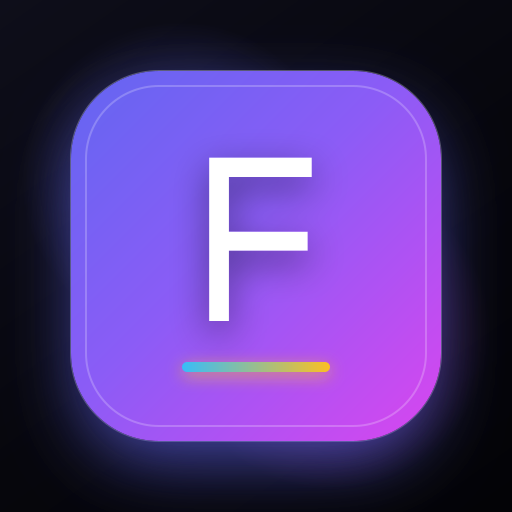

# ForgeOS — Identity & Skill Progression System

<p align="center">
  
</p>

<p align="center">
  <strong>Upgrade Your Human Operating System.</strong><br>
  Stop tracking random chores. Every deliberate action is a vote for the person you choose to become.
</p>

<p align="center">
  <a href="https://play.google.com/store/apps/details?id=com.forgeos.mastery"></a>
  
  
  
</p>

---

## 🎬 Product Showcase Video (16:9 Widescreen)

https://github.com/user-attachments/assets/youtube-16x9.mp4

> **File location**: [`youtube-16x9/youtube-16x9.mp4`](youtube-16x9/youtube-16x9.mp4) (Full HD 1080p, 20s, with synchronized synth sound design)

<p align="center">
  <video src="youtube-16x9/youtube-16x9.mp4" width="100%" controls autoplay loop muted></video>
</p>

> 📱 **Looking for the mobile format?**  
> We also have a native **9:16 vertical video reel** for Instagram Reels, YouTube Shorts, and TikTok: [`instagram-reel/instagram-reel.mp4`](instagram-reel/instagram-reel.mp4).

---

## ⚡ Core Architecture & Features

### 1. 🧬 Identity Vectors (Instead of Chores)
Traditional habit trackers treat your life like a generic grocery checklist. ForgeOS anchors every routine to core identities (e.g., *Systems Craftsman*, *Deep Worker*, *Vitality Athlete*). Every time you execute, you cast a vote and earn tangible XP points toward leveling up your attributes.

### 2. ⏱️ The 2-Minute Gateway Rule
The hardest friction of deep work is the first 120 seconds. Every habit in ForgeOS has an isolated Gateway micro-step (*"Just open your code editor and write 1 line"*). Once your timer passes, inertia drops and flow state takes over.

### 3. 📊 Continuity Grid & Neural Matrix
Compounding consistency visualized over 98+ days. Watch your habits light up like a living neural matrix with real-time streak multipliers.

### 4. 🛡️ Rebound Priority ("Never Miss Twice")
Missing one day is an accident. Missing two days is the start of a bad habit. ForgeOS automatically surfaces and stacks missed routines at the top of your morning queue so momentum is never lost.

### 5. 📱 Android & Web Sync
- **Android Native**: Built with Jetpack Compose & Android WebView architecture, Play Billing Library 8.0, and biometric / Play Pass support.
- **Cross-Platform**: Full Next.js progressive web app with seamless real-time syncing.

---

## 🚀 Getting Started

### Web Application

```bash
# Install dependencies
npm install

# Run development server
npm run dev
```

Open [http://localhost:3000](http://localhost:3000) in your browser.

### Android Application

Open the `android/` directory in **Android Studio**:
```bash
cd android
./gradlew assembleRelease
```

---

## 📦 Video Assets & Studio

All promotional video assets are generated with [OpenFilm](https://github.com/openfilm/openfilm):

| Format | Resolution | Duration | File Path | Best For |
| :--- | :--- | :--- | :--- | :--- |
| **Widescreen** | `1920 × 1080` (16:9) | 20.0s | [`youtube-16x9/youtube-16x9.mp4`](youtube-16x9/youtube-16x9.mp4) | YouTube Main, GitHub README, Website Landing |
| **Vertical Reel** | `1080 × 1920` (9:16) | 18.0s | [`instagram-reel/instagram-reel.mp4`](instagram-reel/instagram-reel.mp4) | Instagram Reels, YouTube Shorts, TikTok |

To live-edit or preview in OpenFilm Studio:
```bash
npx openfilm open youtube-16x9
```

---

## 📄 License & Privacy

ForgeOS is built with strict privacy guarantees. User habits and reflection logs remain strictly user property.  
Compliant with Google Play Store User Data & Data Safety Policies.
